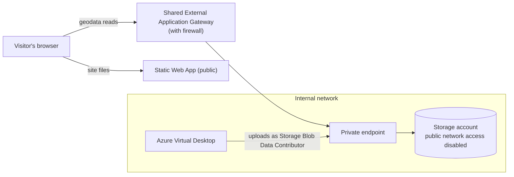

# Architecture: serving the COD website's geodata from Azure

The COD website is a Static Web App with no server code. Its maps and examples
read open, public geodata (about 40 GB, planned at 100 GB) from Azure Storage,
through the shared External Application Gateway and a private endpoint. This
follows the
[Static Content Hosting pattern](https://learn.microsoft.com/en-us/azure/architecture/patterns/static-content-hosting):
public content read anonymously from a storage origin that only a proxy can
reach.

- The storage account holds only this public geodata, with anonymous read on
  its one container.
- Account key access is disabled, and CORS allows reads only from the site's
  address.
- Maintainers upload from Azure Virtual Desktop.

## Cost

About $220 a year at 1,000 visits a month, and about $360 at 10,000. This
covers a Standard Static Web App ($108 a year, plus $0.20 per GB past 100 GB
of site files a month), storage for 100 GB (about $24 a year) and the private
endpoint ($88 a year, plus $0.01 per GB in each direction). It excludes the
shared Application Gateway. Costs use West Europe list prices from the Azure
Retail Prices API, November 2026, and assume 15 MB of site files, 10 MB of
geodata and 200 geodata requests per visit.
