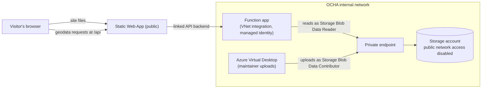
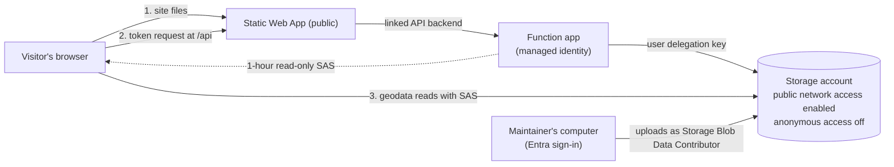

# Architecture options: serving the COD website's geodata from Azure

The COD website is a Static Web App: HTML, CSS and JavaScript that run in the
visitor's browser, with no server of its own. Its maps and examples read open
geodata (about 40 GB, planned at 100 GB) from an Azure storage account.
Because the code runs in the browser, every geodata request starts on the
visitor's machine, outside Azure. The two options below differ in how those
requests reach the storage account. In both, anonymous access stays off and
every read is authenticated.

## Option 1: Function app proxy, private storage

- The browser asks the site's own address for each piece of geodata. The
  Static Web App passes the request to a linked Function app, which reads the
  storage account through its private endpoint and returns the data.
- The storage account has no public network access. The Function app reads
  with its managed identity, and maintainers upload from Azure Virtual Desktop.
- Every map tile and data read runs the Function app, so all geodata passes
  through it and through the Static Web App's bandwidth.

## Option 2: Short-lived read-only SAS, storage read directly

- The browser asks the site for a token once per visit. A linked Function app
  signs a SAS with a user delegation key from its managed identity, then the
  browser reads the storage account directly with it. This is the pattern HDX
  uses with signed S3 links.
- The token is read-only, scoped to the geodata container, can't list or
  write, and expires after 1 hour. The browser asks for a new one when it
  expires.
- The storage account accepts connections from the internet, but rejects any
  request without a valid token. CORS allows reads only from the site's
  addresses.
- Maintainers upload from their own computers, signed in with Entra ID.

## Comparison

|                                          | Option 1: proxy                                                                        | Option 2: SAS                                                           |
| ---------------------------------------- | -------------------------------------------------------------------------------------- | ----------------------------------------------------------------------- |
| Storage network access                   | Disabled, private endpoint only                                                        | Enabled, every request needs a valid token                              |
| Anonymous access                         | Off                                                                                    | Off                                                                     |
| What a visitor can do                    | Read the geodata through the site                                                      | Read the geodata container for 1 hour with the token the site gives out |
| Function app                             | VNet integration, carries all geodata                                                  | No VNet, runs once per visit, never carries data                        |
| Uploads                                  | From Azure Virtual Desktop                                                             | From maintainers' computers                                             |
| Map speed                                | Slower: each read goes through the Function app, with a short delay after idle periods | Same as reading storage directly                                        |
| Code to maintain                         | A data proxy handling partial reads and caching headers                                | A short token function                                                  |
| Yearly cost, about 1,000 visits a month  | About $230                                                                             | About $140                                                              |
| Yearly cost, about 10,000 visits a month | $600 to $1,150                                                                         | $250 to $500                                                            |

Both options include a Standard Static Web App ($108 a year) and storage for
100 GB (about $24 a year). Option 1 also includes the private endpoint ($88 a
year, plus $0.01 per GB of data it carries). Costs use West Europe list prices
from the Azure Retail Prices API, November 2026, and assume 15 MB of site
files, 10 MB of geodata and 200 geodata requests per visit.
